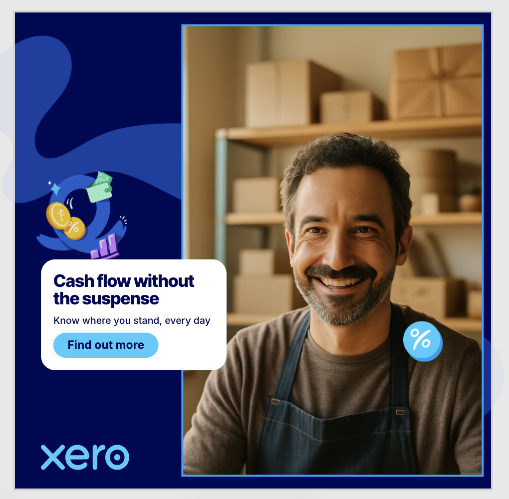
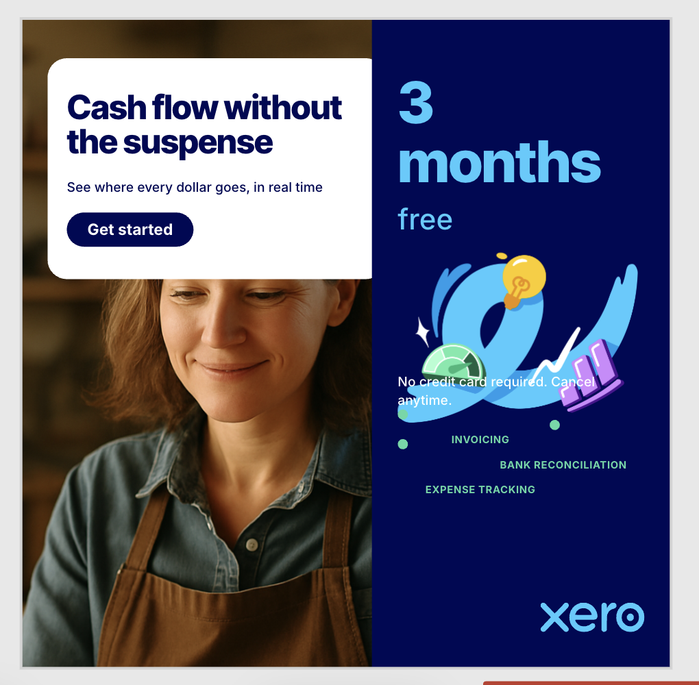
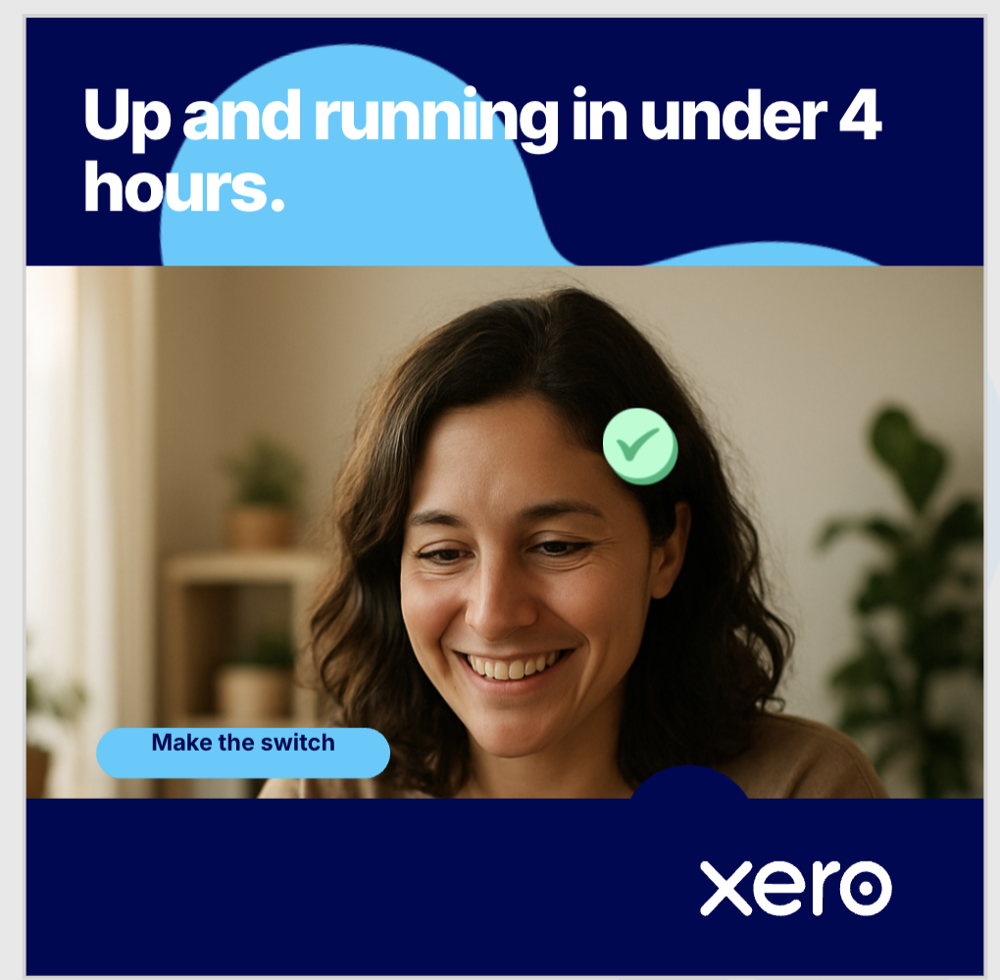
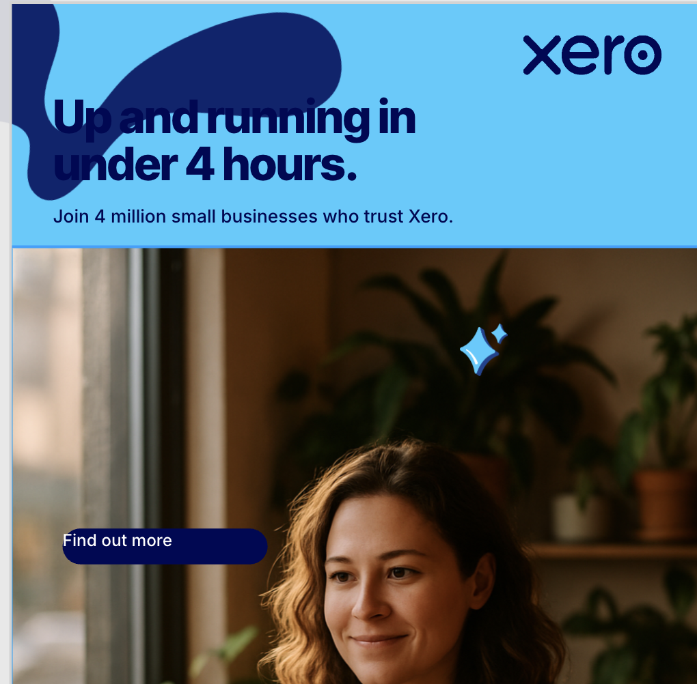
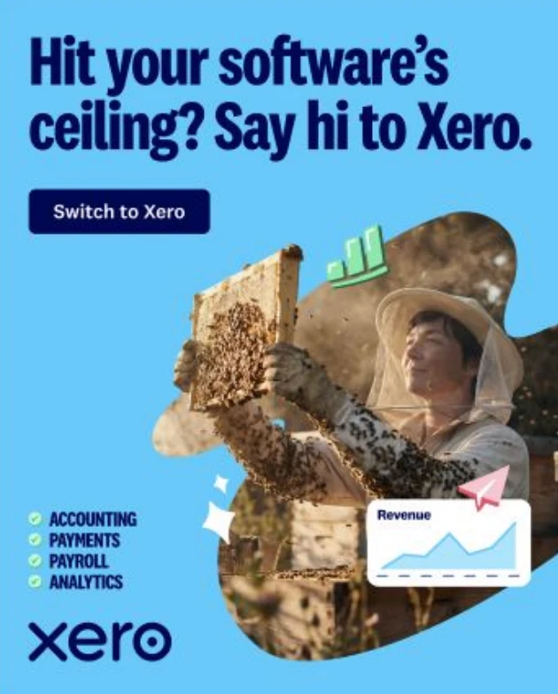
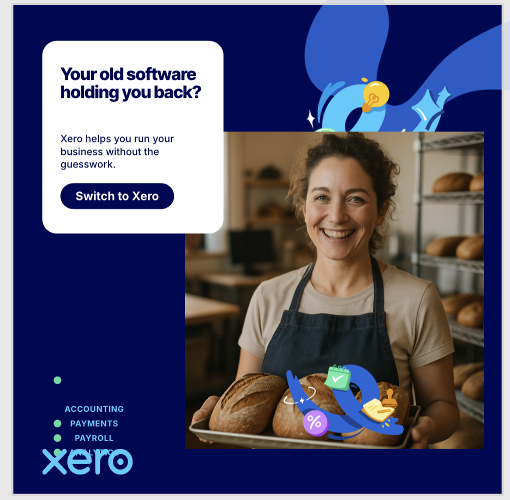

# Brand Copilot

An AI copilot inside a real, layered image editor. It creates, edits and recreates on-brand marketing images as editable canvas layers, for any onboarded brand. Built for the GetCrux AI Hackathon, 17 Oct 2026. Ships with two tenants: Xero and GetCrux.

## Approach

- **Spec, not pixels.** The planner writes a small design spec (cards, text, CTA, image, logo). A server renderer turns it into Polotno layers using the brand's real fonts and assets, with text measured by opentype.js so nothing overlaps.
- **Edits are ops on ids.** The editor sends a compact JSON of every layer. The agent answers with set / add / delete / raise on existing ids, with a rationale. Undo works, the user keeps editing.
- **Deterministic validator.** 16 brand rules (palette, fonts, logo, contrast, overlap, safe zones, alignment) with auto-fix ops. Runs on every agent change and every manual edit.
- **Visual QA loop.** The editor renders the real page, gpt-4.1 inspects it against an 11-point checklist, defects go back to the planner, up to 5 rounds. Every step streams into the chat as an expandable trace.
- **Brand-agnostic.** One folder per tenant under `brands/<id>`. Onboarding scripts download a kit, tag assets with vision, vectorise logos and draft the brand rules.

Models: DeepSeek-V4-Pro plans (text and tools), gpt-4.1 looks (briefs, QA, brand scan), gpt-image-1 paints only when the library has nothing that fits.

Streaming: NDJSON over HTTP POST, with `state_request` / `snapshot_request` events answered by the editor through reply endpoints.

## Run it

Requirements: Node 20+, Python 3 with `gdown` only if you onboard from Google Drive.

```bash
npm install
```

Create `server/.env` (never committed):

```
OPENAI_API_KEY=...
DEEPSEEK_PRO_BASE_URL=...
DEEPSEEK_PRO_KEY=...
DEEPSEEK_PRO_MODEL=DeepSeek-V4-Pro
IMAGE_QUALITY=medium
```

Start both apps:

```bash
npm run dev
```

Editor at http://localhost:5173, API at http://localhost:8787. Tests: `npm test --prefix server`.

## Onboard a brand

```bash
npm run onboard --prefix server -- --brand acme --name "Acme" --drive <folder-url>
npm run vectorize --prefix server -- --brand acme
```

Then curate `brands/acme/brand.json` and pick the brand in the dashboard.

## Test

Reference-based runs on the Xero tenant. Left: the reference handed to the copilot. Right: what it produced as editable pages, each validated by the brand linter and the visual QA loop. All files are under [test/](test/).

### Prompt 1 · “Create different images like this”

Each reference was attached on its own and the prompt sent once. The copilot writes a brief from the reference with GPT-4.1, then builds the pages from Xero's own assets, fonts and palette.

**Image 1** — input, then responses

<p>
  
  &nbsp;→&nbsp;
  
  
</p>

**Image 2** — input, then responses

<p>
  
  &nbsp;→&nbsp;
  
  
</p>

**Image 3** — input, then responses

<p>
  
  &nbsp;→&nbsp;
  
  
  
</p>

**Image 4** — input, then responses

<p>
  
  &nbsp;→&nbsp;
  
  
</p>

### Prompt 2 · competitor ad, remade for Xero

A QuickBooks ad as the reference. The copilot keeps the structure (offer on one side, person on the other) and swaps in Xero's palette, fonts, logo, illustrations and copy.

<p>
  
  &nbsp;→&nbsp;
  
  
</p>

## More

- [docs/how-it-works.html](docs/how-it-works.html): presentation page with the flow, models and a code map per request.
- [docs/](docs/): architecture, flows, image pipeline, agent context, demo script.
