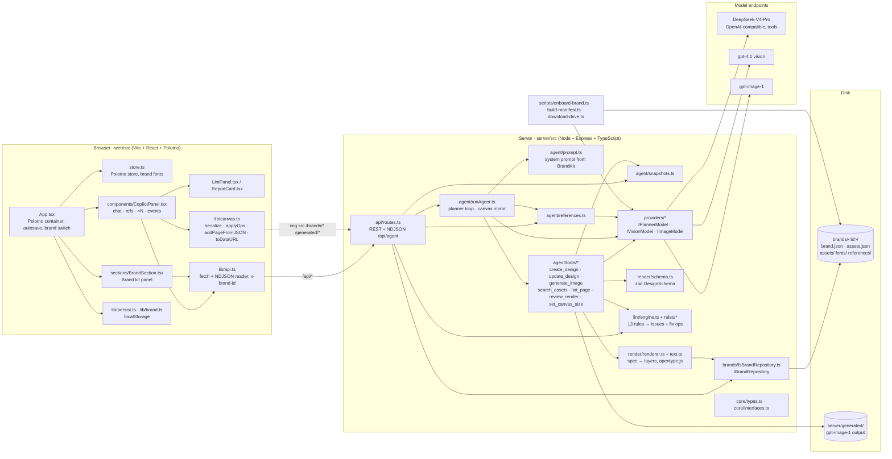

# Architecture

## Component diagram

Dependency direction: everything depends on `core/` contracts; `api/` wires concrete implementations
(`brandRepository()`, `createProviders()`, `defaultLintEngine`, `defaultTools`) in `server/src/index.ts`. No module below
`api/` imports a specific brand or company name.

## Runtime layout

| Process | Port | Serves |
|---|---|---|
| `tsx watch src/index.ts` (server) | 8787 | `/api/*`, static `/brands/*` → `BRANDS_DIR` (default `../brands`), static `/generated/*` → `server/generated` |
| `vite` (web) | 5173 | the editor; proxies `/api`, `/brands`, `/generated` to 8787 |

`npm run dev` at the repo root starts both with `concurrently`. Environment (`server/.env`): `PLANNER_BASE_URL`,
`PLANNER_API_KEY`, `PLANNER_MODEL`, `OPENAI_API_KEY`, `VISION_MODEL`, `IMAGE_MODEL`, optional `BRANDS_DIR`, `PORT`.

## Request lifecycle: `POST /api/agent`

1. **Editor builds the request** (`CopilotPanel.send`). `serializeCanvas(store)` produces `{width, height, pages[] (compact), activePageId, selectedIds}`. References are data URLs (uploads, library images, or a 0.5× JPEG of the active page when "canvas as ref" is on). History is the last 8 user/assistant turns. `variants` comes from the ×N select. The request carries `x-brand-id`.
2. **Route opens the stream.** `routes.ts` sets `application/x-ndjson`, flushes headers, creates an `AbortController` tied to the response `close` event, and calls `runAgent` with `{brandId, brands, providers, lint, tools}`.
3. **Run context.** `runAgent` loads the BrandKit and assets, deep-copies every page into the mirror `Map`, and builds `ToolContext` (`canvas`, `pages`, `emit`, `lint`, `state`, `setCanvas`). `userIsEditing` is true when the active page has elements and no multi-variant request.
4. **Reference brief (optional).** `analyzeReferences` calls the vision model once for all images; failure is reported as a status and ignored.
5. **Messages.** System prompt = brand brief JSON + asset catalogue + `DESIGN_SPEC_DOC` + layout recipes + workflow rules. User message = optional REFERENCE BRIEF + CANVAS STATE (only the active page's elements are expanded) + variants instruction + empty-page hint + USER REQUEST.
6. **Planner loop** (max 14 iterations). Each iteration emits a status, calls `planner.chat(messages, toolDefs)` (temperature 0.7, 6000 max tokens, retry on 429/5xx) and logs latency, tool count and cached tokens. With no tool calls the content becomes the final message. Otherwise each tool call is parsed and executed in order; invalid JSON arguments produce an error string the model can recover from. The abort signal is checked before every planner call and tool call.
7. **Tools emit as they go.** `create_design` streams `page`, `lint`, `report`; `update_design` streams `ops`, then validator `ops`, `lint`, `report`; `set_canvas_size` streams `size`; `review_render` streams `snapshot_request` and waits; `generate_image` writes a PNG under `server/generated` and returns its URL.
8. **Validator.** Every `create_design`/`update_design` ends in `validateAndFix`: lint, apply error-level fix ops (at most two rounds), re-lint, and build a `DesignReport`. Pages touched are recorded in `ctx.state.touched`.
9. **Final pass.** After the loop, each touched page is validated once more; a `lint` event always follows, and a "Final validation" report only if something was fixed. Then `message` is emitted.
10. **Stream close.** The route emits `done` in `finally` and ends the response. Errors thrown by the run become an `error` event first.
11. **Editor applies events** in `handleEvent`: `page` → `addPageFromJSON` (replacing when asked), `ops` → `applyOps` on live elements, `lint` → Brand check tab, `report` → report card plus a 0.12× thumbnail after the page has loaded, `size` → `store.setSize`, `snapshot_request` → `pageToDataURL(0.6)` posted to `/api/snapshot-reply`, `message`/`error` → chat. Autosave writes the store to `localStorage` 800 ms after the last change.

## Other request paths

- **Live lint.** On every store change (debounced 600 ms) the editor posts the active page to `POST /api/lint` and shows the result in the Brand check tab. ⚡ Auto-fix applies every issue's `fix` ops locally; a per-issue Fix applies one.
- **Brand switch.** `setBrandId` persists the choice and notifies listeners; the panel reloads brand, fonts and references, and `App` restores that brand's autosaved canvas or starts a blank page.
- **Asset insertion.** The Brand kit panel adds a library asset to the active page with `custom.assetId` and `custom.role` set, so lint rules treat it like an agent-placed element.
