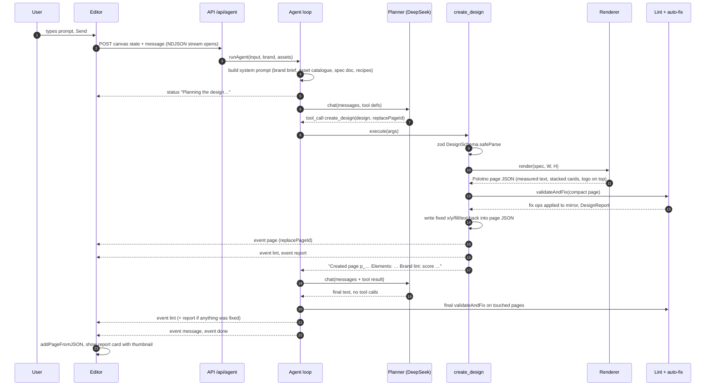
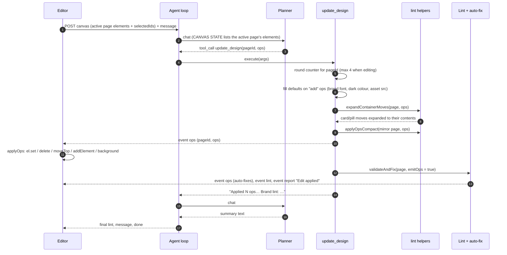
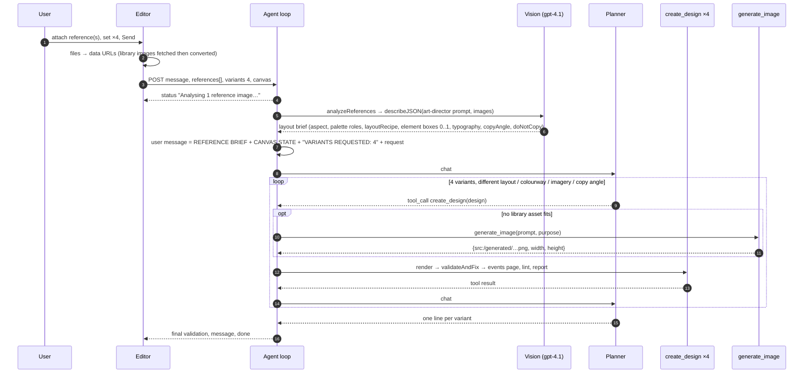
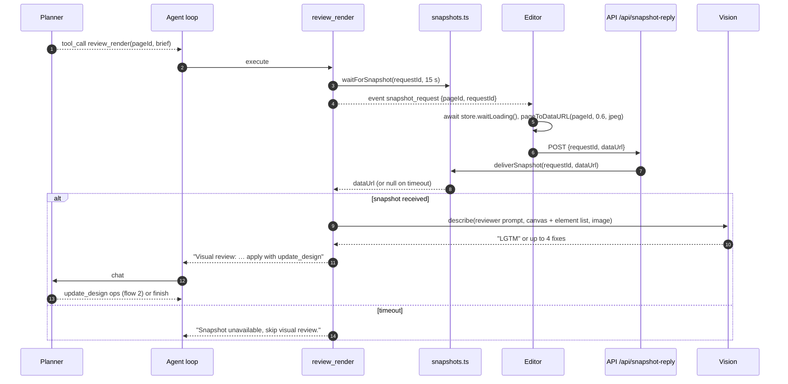
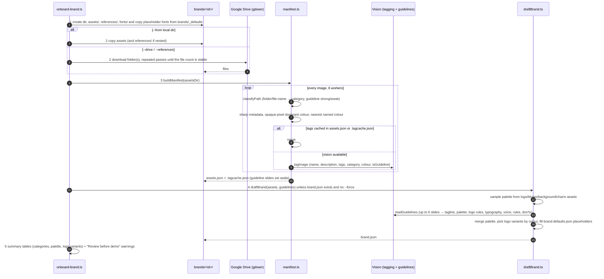

# Flows

Sequence diagrams for the five main paths. Participants map to code:
**Editor** = `web/src/components/CopilotPanel.tsx` + `web/src/lib/canvas.ts`, **API** = `server/src/api/routes.ts`,
**Agent** = `server/src/agent/runAgent.ts`, **Tool** = `server/src/agent/tools/*`, **Renderer** =
`server/src/render/renderer.ts`, **Lint** = `server/src/lint/engine.ts` via `validateAndFix`, **Planner / Vision /
Images** = `server/src/providers/*`.

Every run starts the same way: the editor serialises all pages compactly, sends `POST /api/agent` with the brand id
header, and applies each streamed `AgentEvent` as it arrives. Each diagram below shows what differs.

## 1. Create from blank

Prompt: "Create a 1080×1080 Instagram post announcing a new Xero feature". The active page is empty, so the planner is
told to pass `replacePageId` and fill it instead of adding a page.

Notes
- With `variants > 1` the user message adds "VARIANTS REQUESTED: N" and the planner calls `create_design` N times; each call adds a page and emits its own report card.
- `set_canvas_size` may precede `create_design` when the prompt names a format; it emits a `size` event and rebuilds the system prompt for the new dimensions.
- `generate_image` may be called first when no library asset fits; its `/generated/<id>.png` URL is then used as an image `src` in the spec.

## 2. Edit the current page with ops

Prompt: "Make the headline punchier and move the logo to the bottom right", with or without a selection. The active
page has elements, so `userIsEditing` is true and the planner is told to use `update_design` with precise ops on
existing ids. Up to four `update_design` rounds per page are allowed in this mode.

Notes
- The browser applies ops on live Polotno elements, so Polotno's undo history captures each change.
- Lint fixes emitted here are ordinary `ops` events; the editor cannot tell them from planner edits, which is why the report card lists `autoFixed` separately.
- ✨ Fix with AI in the Brand check tab is this same flow with the prompt "Fix all brand compliance issues on the current page, including the judgement calls."

## 3. Reference-based variants

Prompt: "Create 4 different images like this" with one or more reference images attached (file upload, the brand's
`references/` library, or a JPEG of the current page when "canvas as ref" is on) and ×4 selected.

Notes
- If reference analysis throws, the run continues without the brief and says so in a status line.
- The brief is brand-neutral by construction: boxes are normalised, and `doNotCopy` lists reference-specific items the planner must swap for the target brand's assets.
- The vision call accepts up to six images at `detail: high`.

## 4. Visual review snapshot round-trip

`review_render` lets the planner see the page as the browser actually renders it (real fonts, cropped photos) and get
up to four concrete fixes from an art-director prompt. The server never rasterises; it asks the editor.

Notes
- The pending map is in-process, so the reply must reach the same server that emitted the request.
- The element list sent with the image carries ids and boxes so the critique can be turned into ops without guessing.

## 5. Brand onboarding pipeline

`npm run onboard --prefix server -- --brand <id> --name "<Name>" (--drive <url> [--references <url>] | --from <dir>)`.
Five steps, each printed with a progress line; a dry run computes everything and writes nothing.

Notes
- `npm run manifest` re-runs step 3 alone (incremental; `--retag` forces re-tagging). `npm run download` re-runs step 2 alone.
- The server picks the new brand up without a restart; the editor lists it in the brand switcher after a reload.
- Details of what to review are in [brand-onboarding.md](brand-onboarding.md).
